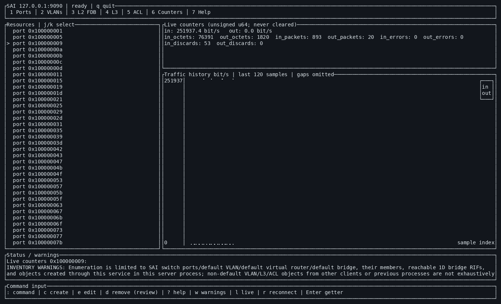
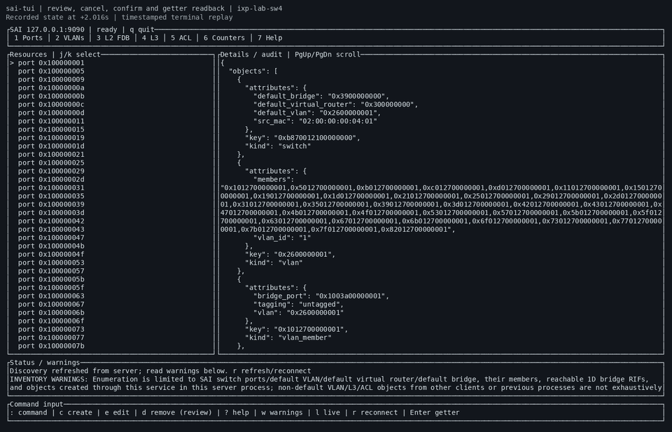
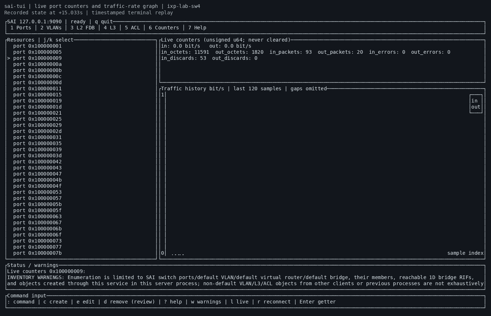
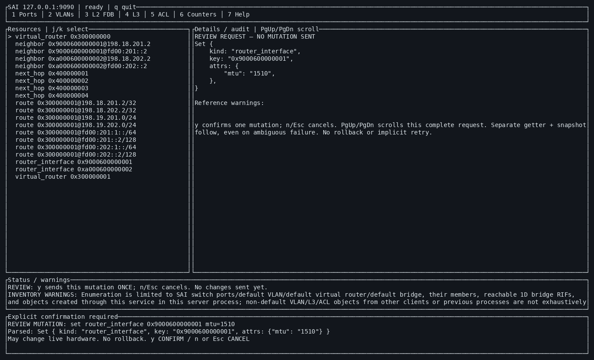
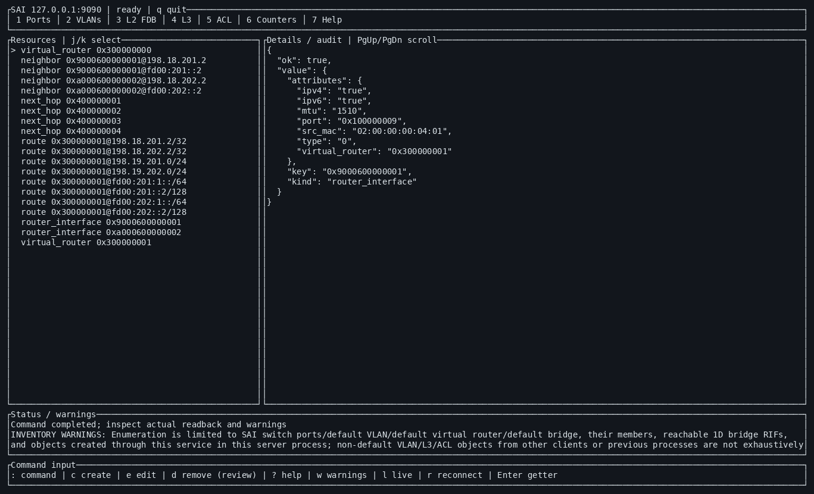

# saiserver and sai-tui

`sai-tui` is a Rust/Ratatui client for bounded SAI management over the existing
binary/buffered Thrift endpoint. It provides VLAN/access/trunk and L2 FDB views,
IPv4/IPv6 router-interface/neighbor/next-hop/route management, basic permit/deny
ACLs and bindings, plus live unsigned port counters and traffic-rate graphs.
Mutations require an explicit review/confirmation and real server readback;
unsupported or unverified operations remain visible failures, never fake state.

## TUI showcase

Recorded on **ixp-lab-sw4**, talking to the real SAI Thrift service while
**ixp-lab-eos1** supplied and verified traffic. See the
[live verification record](docs/lab-verification.md) for results and SDK limits.



### Screencasts

| Review, cancel, confirm and read back configuration | Live counters and traffic-rate history |
| --- | --- |
| [](docs/media/sai-tui-configuration.mp4) | [](docs/media/sai-tui-counters.mp4) |
| [Watch/download MP4 · 11 seconds](docs/media/sai-tui-configuration.mp4) | [Watch/download MP4 · 13 seconds](docs/media/sai-tui-counters.mp4) |

These are **timed replays of terminal snapshots from the actual live session**,
not mock data or a new switch run. Recorded states are held between their
capture timestamps, with a one-second final freeze; they are not continuous
frame-by-frame recordings. GIF previews play inline on GitHub; click through
for the full-resolution H.264 videos. [Source capture and regeneration](docs/media/README.md).

<details>
<summary>More screenshots: explicit mutation review and actual getter readback</summary>





</details>

## Hermetic Bazel / Bzlmod build

On Linux x86_64, use the digest-pinned bootstrap (Docker or Podman):

```sh
./bazelw build //:client //:server
./bazelw test //...
```

The bootstrap pins Bazel **9.3.1** and its Linux/Bash/coreutils environment.
Bazel downloads pinned Rust/LLVM toolchains, Thrift sources and SAI headers;
no installed compiler, Cargo, Thrift or vendor SDK is needed for the build.
The standalone server requires an explicit `SAI_LIBRARY_PATH` **at runtime**.
Native `bazel`/Bazelisk commands also work, but do not pin the host bootstrap
userspace; use `bazelw` for the fully hermetic configuration.

Public targets include `@saiserver//:client_lib`, `:server_lib`, `:sai_headers`,
`:thrift_idl`, `:thrift_cpp` and `:thrift_rust`.
See [Bazel targets, hermeticity boundary, SDK deployment and downstream use](docs/bazel.md)
and the [separate Bzlmod consumer example](examples/bazel).

## Run the TUI

Requires Rust 1.89+ and an **already running compatible saiserver**:

```sh
cargo build --manifest-path tui/Cargo.toml --release --locked
./tui/target/release/sai-tui --endpoint 127.0.0.1:9090
```

Use `1`–`7`/Tab for pages, `j`/`k` to select, `r` to refresh/reconnect, `:` for
commands, `p` to load a switch preset locally, `a` to separately review applying
it, `y` to confirm the labelled review action and `q` to quit. `--help` describes
headless JSON commands and sampling. The protocol has no authentication/TLS;
use an isolated host or SSH tunnel, not an untrusted network.

- [Switch presets: Seastone 2, separate load/apply, ERSPAN and operational ARP/NDP](docs/switch-presets.md)
- [Build, keys, workflows, tests and limitations](docs/tui.md)
- [Bounded Thrift contract](docs/tui-api.md) and [server adapter/build](docs/server-api.md)
- [Actual sw4/EOS verification, recorded TUI and restoration](docs/lab-verification.md)

The live record covers access/trunk forwarding, FDB learning, explicit IPv4/IPv6
routing, ACL deny/permit/bind/unbind effects and nonzero counter graphs. It also
identifies Broadcom SDK getter/deletion-verification limits and tagging changes
that require explicit replacement. The lab was restored to SONiC afterward;
a test server is deliberately **not** left owning its ASIC.

## Usage inside SONiC

**Starting saiserver initializes the ASIC and can interrupt all forwarding.**
Do not run it alongside SONiC's SDK owner or stop SONiC on a shared switch
without explicit authority and a restoration baseline. For an authorized
unattended session, `--no-shell` disables the interactive SDK shell. Container
runs of the tested SDK need `--shm-size=512m`; the default 64MiB is insufficient.
The commands below are low-level SDK setup, not prerequisites for merely
building the Rust client. Deployments can override the unicast default switch
MAC with `SAI_SRC_MAC=02:00:00:00:00:01`; the server prints the address selected.

Build the server on a Linux x86_64 machine with `./bazelw build //:server` and
copy it to the switch (see [obtaining binaries](docs/bazel.md#obtaining-binaries-and-vendor-sdk-deployment)).
It does not link against libsai; the SDK is chosen when it starts.

```
# Download a matching libsai for your kernel driver
./download-brcm-sai.sh

sudo apt install ./libsaibcm*.deb

sudo systemctl stop swss
sudo systemctl stop syncd
sudo mknod /dev/linux-user-bde c 126 0
sudo rmmod linux_knet_cb
sudo rmmod psample

# copy broadcom config to config.bcm and/or modifiy sai.profile to match
sudo SAI_LIBRARY_PATH=/usr/lib/libsai.so ./saiserver -p sai.profile
```

## Re-generate SAI Python library

```
pip3 install --user ctypesgen
ctypesgen ~/Downloads/SAI/inc/sai*.h -I ~/Downloads/SAI/inc -I ~/Downloads/SAI/experimental/ -o sai_types.py
# or
ctypesgen /usr/include/sai/sai*.h -I /usr/include/sai/ -I /usr/include/sai/experimental/ -o sai_types.py
```

## Example run

```
admin@sonic:~/saiserver$ sudo ./saiserver -p sai.profile
profile map file: sai.profile
insert: SAI_INIT_CONFIG_FILE:config.bcm
resetting profile map iteratorkey: SAI_INIT_CONFIG_FILE:config.bcmiterator reached endFound 0 devices.
linux-user-bde:new probed device unit 0 dev_no 0 _ndevices 1
DMA pool size: 33554432 bytes.
BDE dev 0 (PCI), Dev 0xb873, Rev 0x01, Chip BCM56873_A0, Driver BCM56870_A0
SOC unit 0 attached to PCI device BCM56873_A0
rc: unit 0 device BCM56873_A0
0:soc_trident3_chip_reset: TS_PLL locked on unit 0 using 50.0MHz external reference clock
Recommended to add "ptp_ts_pll_fref=50000000" config variable
0:soc_trident3_chip_reset: BS_PLL0 locked on unit 0 using 50.0MHz external reference clock
Recommended to add "ptp_bs_fref_0=50000000" config variable
0:soc_trident3_chip_reset: BS_PLL1 locked on unit 0 using 50.0MHz external reference clock
Recommended to add "ptp_bs_fref_1=50000000" config variable
UNIT0 CANCUN: 
        CIH: LOADED
        Ver: 06.04.01
        Bug fix rev: 1

        CMH: LOADED
        Ver: 06.04.01
        Bug fix rev: 1
        SDK Ver: 06.05.27

        CCH: LOADED
        Ver: 06.04.01
        Bug fix rev: 1
        SDK Ver: 06.05.27

        CEH: LOADED
        Ver: 06.04.01
        Bug fix rev: 1
        SDK Ver: 06.05.27

rc: MMU initialized
*** unit 0: ports capable of limited speed range cut-thru
ALPM Distributed HITBIT thread enabled (interval 1000000 us)
*** unit 0: alpm forwarding level 2 loaded: 4 banks in combined-128 
0:bcmi_xgs5_bfd_init: uKernel BFD application not available
0:bcm_xgs5_telemetry_eapp_init: uKernel Telemetry application not available
0:bcm_esw_ifa_init: uKernel IFA application not available
rc: L2 Table shadowing enabled
rc: Port modes initialized
rc: platform SDK init complete
Starting SAI RPC server on port Hit enter to get drivshell prompt..
9092
create pthread switch_sai_thrift_rpc_server_thread result 0
detach switch_sai_thrift_rpc_server_thread rc0

Enter 'quit' to exit the application.
drivshell>
drivshell>ps
                 ena/        speed/ link auto    STP                  lrn  inter   max   cut   loop        
           port  link  Lns   duplex scan neg?   state   pause  discrd ops   face frame  thru?  back   encap
       xe0( 49)  !ena   1   25G  FD   SW  No   Forward          None   FA     CR  9412    No          IEEE
       xe1( 50)  !ena   1   25G  FD   SW  No   Forward          None   FA     CR  9412    No          IEEE
       xe2( 51)  !ena   1   25G  FD   SW  No   Forward          None   FA     CR  9412    No          IEEE
       xe3( 52)  !ena   1   25G  FD   SW  No   Forward          None   FA     CR  9412    No          IEEE
       xe4( 57)  !ena   1   25G  FD   SW  No   Forward          None   FA     CR  9412    No          IEEE
       xe5( 58)  !ena   1   25G  FD   SW  No   Forward          None   FA     CR  9412    No          IEEE
       xe6( 59)  !ena   1   25G  FD   SW  No   Forward          None   FA     CR  9412    No          IEEE
       xe7( 60)  !ena   1   25G  FD   SW  No   Forward          None   FA     CR  9412    No          IEEE
       xe8( 61)  !ena   1   25G  FD   SW  No   Forward          None   FA     CR  9412    No          IEEE
       xe9( 62)  !ena   1   25G  FD   SW  No   Forward          None   FA     CR  9412    No          IEEE
      xe10( 63)  !ena   1   25G  FD   SW  No   Forward          None   FA     CR  9412    No          IEEE
      xe11( 64)  !ena   1   25G  FD   SW  No   Forward          None   FA     CR  9412    No          IEEE
      xe12( 79)  !ena   1   25G  FD   SW  No   Forward          None   FA     CR  9412    No          IEEE
      xe13( 80)  !ena   1   25G  FD   SW  No   Forward          None   FA     CR  9412    No          IEEE
      xe14( 81)  !ena   1   25G  FD   SW  No   Forward          None   FA     CR  9412    No          IEEE
      xe15( 82)  !ena   1   25G  FD   SW  No   Forward          None   FA     CR  9412    No          IEEE
      xe16( 87)  !ena   1   25G  FD   SW  No   Forward          None   FA     CR  9412    No          IEEE
      xe17( 88)  !ena   1   25G  FD   SW  No   Forward          None   FA     CR  9412    No          IEEE
      xe18( 89)  !ena   1   25G  FD   SW  No   Forward          None   FA     CR  9412    No          IEEE
      xe19( 90)  !ena   1   25G  FD   SW  No   Forward          None   FA     CR  9412    No          IEEE
      xe20( 95)  !ena   1   25G  FD   SW  No   Forward          None   FA     CR  9412    No          IEEE
      xe21( 96)  !ena   1   25G  FD   SW  No   Forward          None   FA     CR  9412    No          IEEE
      xe22( 97)  !ena   1   25G  FD   SW  No   Forward          None   FA     CR  9412    No          IEEE
      xe23( 98)  !ena   1   25G  FD   SW  No   Forward          None   FA     CR  9412    No          IEEE
      xe24( 13)  !ena   1   25G  FD   SW  No   Forward          None   FA     CR  9412    No          IEEE
      xe25( 14)  !ena   1   25G  FD   SW  No   Forward          None   FA     CR  9412    No          IEEE
      xe26( 15)  !ena   1   25G  FD   SW  No   Forward          None   FA     CR  9412    No          IEEE
      xe27( 16)  !ena   1   25G  FD   SW  No   Forward          None   FA     CR  9412    No          IEEE
      xe28( 21)  !ena   1   25G  FD   SW  No   Forward          None   FA     CR  9412    No          IEEE
      xe29( 22)  !ena   1   25G  FD   SW  No   Forward          None   FA     CR  9412    No          IEEE
      xe30( 23)  !ena   1   25G  FD   SW  No   Forward          None   FA     CR  9412    No          IEEE
      xe31( 24)  !ena   1   25G  FD   SW  No   Forward          None   FA     CR  9412    No          IEEE
      xe32( 29)  !ena   1   25G  FD   SW  No   Forward          None   FA     CR  9412    No          IEEE
      xe33( 30)  !ena   1   25G  FD   SW  No   Forward          None   FA     CR  9412    No          IEEE
      xe34( 31)  !ena   1   25G  FD   SW  No   Forward          None   FA     CR  9412    No          IEEE
      xe35( 32)  !ena   1   25G  FD   SW  No   Forward          None   FA     CR  9412    No          IEEE
      xe36( 99)  !ena   1   25G  FD   SW  No   Forward          None   FA     CR  9412    No          IEEE
      xe37(100)  !ena   1   25G  FD   SW  No   Forward          None   FA     CR  9412    No          IEEE
      xe38(101)  !ena   1   25G  FD   SW  No   Forward          None   FA     CR  9412    No          IEEE
      xe39(102)  !ena   1   25G  FD   SW  No   Forward          None   FA     CR  9412    No          IEEE
      xe40(107)  !ena   1   25G  FD   SW  No   Forward          None   FA     CR  9412    No          IEEE
      xe41(108)  !ena   1   25G  FD   SW  No   Forward          None   FA     CR  9412    No          IEEE
      xe42(109)  !ena   1   25G  FD   SW  No   Forward          None   FA     CR  9412    No          IEEE
      xe43(110)  !ena   1   25G  FD   SW  No   Forward          None   FA     CR  9412    No          IEEE
      xe44(115)  !ena   1   25G  FD   SW  No   Forward          None   FA     CR  9412    No          IEEE
      xe45(116)  !ena   1   25G  FD   SW  No   Forward          None   FA     CR  9412    No          IEEE
      xe46(117)  !ena   1   25G  FD   SW  No   Forward          None   FA     CR  9412    No          IEEE
      xe47(118)  !ena   1   25G  FD   SW  No   Forward          None   FA     CR  9412    No          IEEE
       ce0( 67)  !ena   4  100G  FD   SW  No   Forward          None   FA    CR4  9412    No          IEEE
       ce1( 71)  !ena   4  100G  FD   SW  No   Forward          None   FA    CR4  9412    No          IEEE
       ce2(123)  !ena   4  100G  FD   SW  No   Forward          None   FA    CR4  9412    No          IEEE
       ce3(127)  !ena   4  100G  FD   SW  No   Forward          None   FA    CR4  9412    No          IEEE
       ce4(  1)  !ena   4  100G  FD   SW  No   Forward          None   FA    CR4  9412    No          IEEE
       ce5( 33)  !ena   4  100G  FD   SW  No   Forward          None   FA    CR4  9412    No          IEEE
       ce6(  5)  !ena   4  100G  FD   SW  No   Forward          None   FA    CR4  9412    No          IEEE
       ce7( 41)  !ena   4  100G  FD   SW  No   Forward          None   FA    CR4  9412    No          IEEE
drivshell>
```

Use `./saiclient` to set all ports to enabled. It needs the `thrift` Python
package and the bindings from `bazel build //idl:switch_sai_py`; set
`SAI_THRIFT_PY` to their directory if you copied them elsewhere.
